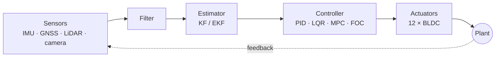

## 🚁 Flagship — Isaac_ROS-Jetbot_NanoOWL

A Jetson Orin Nano Super platform for a **coaxial X12 hexacopter** and a **ground robot**:
open-vocabulary perception with NanoOWL, sensor fusion, flight control, simulation and OTA updates.

<table>
  <tr>
    <td width="33%" valign="top">
      <b>👁️ Perception</b> 
      Isaac ROS · NanoOWL TensorRT · CUDA <code>sm_87</code> · VPI
    </td>
    <td width="33%" valign="top">
      <b>🎛️ Control</b> 
      Derived, closed-loop designs GM ≥ 6 dB · PM ≥ 45°
    </td>
    <td width="33%" valign="top">
      <b>🔧 Embedded</b> 
      STM32N6 · FreeRTOS · TrustZone Portenta H7 · ESP32 · OpenMV
    </td>
  </tr>
</table>

## 🛠️ Stack

## 📌 More

[Projects](https://github.com/TNG-Blue/.github/blob/master/profile/PROJECTS.md) ·
[Tech stack](https://github.com/TNG-Blue/.github/blob/master/profile/TECH_STACK.md) ·
[Research](https://github.com/TNG-Blue/.github/blob/master/profile/RESEARCH.md) ·
[Documentation](https://tng-blue.github.io/Isaac_ROS-Jetbot_NanoOWL-Docs/)

