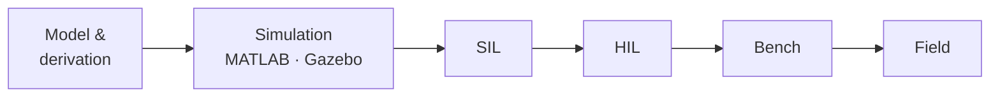

## 👋 About us

**TNG-Blue** builds autonomous machines end to end — from the microcontroller that spins the motor
to the GPU that sees the scene and the cloud that updates the fleet. We work in the open under
**Apache-2.0** and favour engineering that can be proven: every controller is derived from a model,
closed-loop, and verified before it moves real hardware.

<table>
  <tr>
    <td width="25%" valign="top">
      <b>🤖 Robotics</b> 
      ROS 2 · Nav2 · SLAM Gazebo simulation
    </td>
    <td width="25%" valign="top">
      <b>👁️ Edge AI</b> 
      Jetson · CUDA · TensorRT Isaac ROS · OpenCV · VPI
    </td>
    <td width="25%" valign="top">
      <b>🎛️ Control</b> 
      KF / EKF · PID · LQR MPC · FOC · MATLAB
    </td>
    <td width="25%" valign="top">
      <b>🔧 Embedded</b> 
      STM32 · ESP32 · OpenMV FreeRTOS · TrustZone
    </td>
  </tr>
</table>

## 🚀 Projects

| Project | What it is | Platform |
|---------|------------|----------|
| **Isaac_ROS-Jetbot_NanoOWL** · [docs](https://tng-blue.github.io/Isaac_ROS-Jetbot_NanoOWL-Docs/) | Hexacopter + ground-robot platform with open-vocabulary perception | Jetson Orin Nano Super |
| **JetOwl** | Flight-control and vision firmware | STM32N657 |
| **Jetbot Nano** | ROS 2 mobile robot with ESP32 motor bridge | Jetson Nano · ESP32 |
| **VPI Detection** | Training-free, hardware-accelerated object detection | Jetson · VPI |
| **Portenta H7** | Dual-core real-time firmware | STM32H747 |

## 🧭 How we work

## 🛠️ Stack

[Projects](https://github.com/TNG-Blue/.github/blob/master/profile/PROJECTS.md) ·
[Tech stack](https://github.com/TNG-Blue/.github/blob/master/profile/TECH_STACK.md) ·
[Research](https://github.com/TNG-Blue/.github/blob/master/profile/RESEARCH.md)

